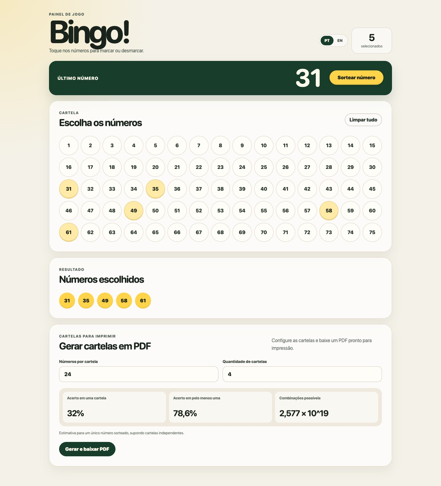

# Bingo

[English](#english) · [Português](#português)



## English

A lightweight, responsive bingo number board built with plain HTML, CSS, and JavaScript.

Live demo: [franzejr.github.io/bingo](https://franzejr.github.io/bingo/)

### Features

- Select or deselect numbers from 1 to 75.
- Draw random numbers without repeats.
- Generate unique random bingo cards as a print-ready PDF.
- Configure the number of entries per card and the number of cards.
- View single-draw probability estimates for the current card configuration.
- See the latest selected number.
- Review selected numbers in ascending order.
- Clear the full selection.
- Switch the interface between English and Brazilian Portuguese.
- Keep the selected language between browser sessions.

### Run locally

No dependencies or build step are required. Open `index.html` directly or serve the directory with a local HTTP server:

```bash
python3 -m http.server 4173 --bind 127.0.0.1
```

Then visit `http://127.0.0.1:4173`.

### Development conventions

- All commit messages must be written in English.
- User-facing text must be available in English and Brazilian Portuguese.
- Keep the project dependency-free unless a new requirement clearly benefits from a dependency.

### License

This project is open source and available under the [MIT License](LICENSE).

---

## Português

Um painel de números de bingo leve e responsivo, criado com HTML, CSS e JavaScript puro.

Demo ao vivo: [franzejr.github.io/bingo](https://franzejr.github.io/bingo/)

### Funcionalidades

- Selecione ou desmarque números de 1 a 75.
- Sorteie números aleatórios sem repetição.
- Gere cartelas aleatórias únicas em um PDF pronto para impressão.
- Configure a quantidade de números por cartela e a quantidade de cartelas.
- Consulte estimativas de probabilidade para um único sorteio.
- Veja o último número selecionado.
- Consulte os números escolhidos em ordem crescente.
- Limpe toda a seleção.
- Alterne a interface entre inglês e português brasileiro.
- Mantenha o idioma selecionado entre sessões do navegador.

### Executar localmente

Não é necessário instalar dependências nem compilar o projeto. Abra o arquivo `index.html` diretamente ou sirva a pasta com um servidor HTTP local:

```bash
python3 -m http.server 4173 --bind 127.0.0.1
```

Depois, acesse `http://127.0.0.1:4173`.

### Convenções de desenvolvimento

- Todas as mensagens de commit devem ser escritas em inglês.
- Todo texto exibido ao usuário deve estar disponível em inglês e português brasileiro.
- Mantenha o projeto sem dependências, a menos que um novo requisito se beneficie claramente de uma delas.

### Licença

Este projeto é open source e está disponível sob a [Licença MIT](LICENSE).
